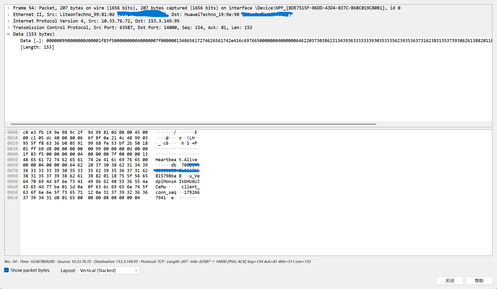
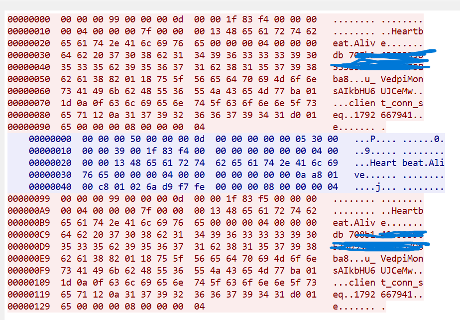
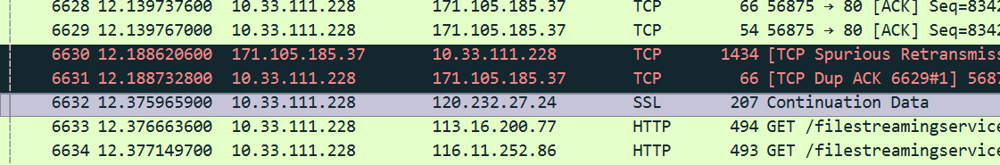

# QQ 流量抓包与分析实验报告

## 一、实验目的

通过 `Wireshark` 捕获 `QQ` 客户端的网络流量，分析其通信所使用的传输层协议（`TCP/UDP`）、数据是否加密，并观察QQ客户端与服务器之间的保活机制，理解即使通讯软件如何通过周期性心跳维持在线状态，并分析其底层传输特征底层。

## 二、实验环境与方法

- **环境**：`Windows` 主机 + `Wireshark` + `QQ` 客户端
- **方法**：
  1. 启动 `Wireshark`，选择`WLAN`网卡开始捕获。
  2. 登录 `QQ`，进行发送消息、传输文件等操作。
  3. 停止捕获，用过滤器筛选 `QQ` 相关流量。
  4. 分析每个数据包的传输层协议、端口号、载荷内容。
  5. 对疑似文件传输的流量，尝试根据文件头部特征码提取原始数据。

## 三、隐私声明

为保护个人隐私，本文中所有涉及账号、密码、聊天内容、IP 地址等敏感信息，均已做脱敏处理（如打码、替换为 `xxx`）。文中出现的文件传输示例仅用于技术分析，不涉及真实个人数据。

## 四、实验分析

### 4.1 传输层协议分析（TCP / UDP）

通过` Wireshark` 捕获 `QQ `客户端流量，在显示过滤器中使用 `oicq` 未能筛选出任何数据包。进一步使用本机 IP 地址（`ip.addr == 你的IP`）进行过滤后，对捕获到的数据包进行统计分析，发现 QQ 的通信流量具有以下特征：

- **主要协议**：`TCP` 协议占绝对主导，`UDP` 流量极少或没有。
- **主要端口**：`TCP 443` 端口是 `QQ` 通信的主要端口，用于建立长连接和传输数据。
- **协议伪装**：`QQ` 的流量在 `Wireshark` 中显示为 `TLSv1.2` 或 `TLSv1.3`，即 `QQ` 使用了 `TLS `加密来保护通信内容，与普通 `HTTPS` 网站的流量特征一致。

**结论**：新版` QQ` 已从早期的 `UDP` 明文通信，全面转向基于 `TCP 443` 端口的加密通信。

### 4.2 心跳包特征识别

#### 4.2.1 TCP心跳机制概述

在讲心跳机制之前，我们要先明白TCP长连接的缺点和可能出现的问题。

> `长连接的坑不在于TCP的不可靠，而在于连接状态是分布式保存在两端 + 沿途每台中间设备里的，而中间设备会单方面把状态删掉，且不通知任何人。`

1. **资源占用高**：每条连接都要占 fd、缓冲区和内存，百万连接就是数 GB 到数十 GB。
2. **中间设备不可控**：防火墙、负载均衡、反向代理以及NAT网关都有空闲超时，超时后静默丢包。
3. **传输层限制**：队头阻塞、Nagle延迟、丢包后拥塞窗口(cwnd)塌缩，切换网络后连接直接作废。
4. **半开连接(half-open)**：对端进程崩了、机器断电或者中间设备悄悄删除状态，但本机TCP状态机还停留在`ESTABLISED`。
5. **keep-alive机制不够用**：`Linux`默认2小时探测一次，而且只探测对方内核，即使对方进程卡死，只要内核活着，照样回ACK。

为了解决上述问题，应用层普遍引入**心跳机制（Heartbeat）**：客户端以固定或自适应的时间间隔，向服务器发送一个体积很小的保活报文，服务器收到后予以响应或更新在线状态。心跳包不承载业务数据，其唯一作用就是确认对端的连接和业务状态，从而刷新中间设备的连接映射，维持长连接的可用性。

本次抓包中观察到的周期性交互，正是 QQ 客户端维持在线状态的心跳行为。根据课堂演示的方法，通过 Wireshark 的查找功能在分组字节流中全局搜索 `heartbeat` 字符串，精准定位到了 QQ 客户端与服务器之间的心跳包交互。





载荷结构简单分析：

```
Heartbeat.Alive     <--心跳包标识
708b1…………ba8        <--16字节设备指纹
u_VedpiMonsAIkbHU6UJCeMw       <--客户端标识
1792667941      <--连接序号
```


QQ 的心跳包通过 443 端口的 TLS 连接传输，Wireshark 的 Info 列显示为 Continuation Data。心跳是双向的：客户端每发出一个，服务端就返回一个；抓到的数据里可以直接看到明文的 QQ 号。

- **底层协议与端口**：观察这些心跳包的传输层信息，通常承载于 TCP 协议之上（如 443 端口或腾讯特定服务端口）。它们作为长连接的一部分，周期性发送。

- **心跳包与加密流的关联**：虽然通过特征字符串可以成功定位到心跳包，但进一步选中数据包查看其十六进制载荷（或追踪 TCP 流），会发现数据段开头包含 `16 03 01` 或 `16 03 03` 等标准 TLS 握手特征字节。这表明**心跳包的数据载荷同样是经过 TLS 加密的密文**，无法直接读取具体内容。

- **版本演变对比**：早期 QQ 版本（如 2008 年前后）曾使用 **UDP 8000** 端口进行明文传输，心跳与业务数据极易被截获分析；而现今版本已全面升级为基于 TCP/TLS 的加密通信。

> **结论**：现代 QQ 通信（包括心跳包及业务数据）已实现全面加密。尽管我们可以通过搜索特征字符串定位到心跳包的行为规律，但在未获取会话密钥的情况下，其内部载荷属于 TLS 密文，无法通过简单的抓包直接读取明文。

### 4.3 文件传输与恢复尝试

**1. 文件头特征码分析**

不同文件类型在开头有固定的“特征码”（Magic Number），可作为识别文件类型的依据：

| 文件类型 | 特征码（十六进制）     | 说明          |
|:---- |:------------- |:----------- |
| JPG  | `FF D8 FF`    | JPEG 图片起始标志 |
| PNG  | `89 50 4E 47` | PNG 图片起始标志  |
| PDF  | `25 50 44 46` | PDF 文件起始标志  |
| ZIP  | `50 4B 03 04` | ZIP 压缩包起始标志 |
| RAR  | `52 61 72 21` | RAR 压缩包起始标志 |

**2. 尝试恢复文件**

在 `Wireshark` 中，使用过滤器 `tcp.port == 443`和`ip.src==（IP地址）` 筛选 `QQ` 流量后，尝试搜索文件头特征码（如 `FF D8 FF`），结果未能找到任何明文文件头。

**原因分析**：

- QQ 的文件传输同样走 TLS 加密通道，文件内容在传输前已被加密。
- 即使捕获到传输过程，看到的也只是 TLS 密文，无法直接提取原始文件。

**3. 结论**

新版 QQ 的文件传输采用加密方式，无法通过 Wireshark 直接恢复明文文件。若需分析文件内容，只能通过其他方式（如接收端保存的文件本身）进行。

### 4.4 总结

| 分析维度      | 结论                              |
|:--------- |:------------------------------- |
| **传输层协议** | 主要使用 TCP，端口 443                 |
| **加密方式**  | 全程 TLS 加密，无明文                   |
| **文件传输**  | 加密传输，无法直接恢复明文                   |
| **协议识别**  | Wireshark 无法识别为 OICQ 协议，显示为 TLS |