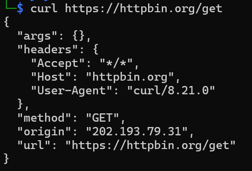
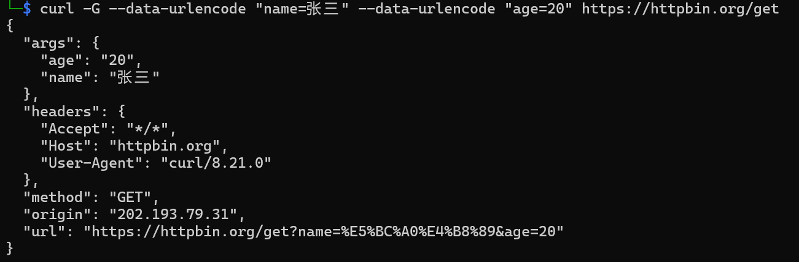

# curl 从入门到上手：7 个真实场景 + 性能排查 + 一份能直接抄的命令速查表

> 做接口调试时，浏览器能做的事其实很有限：看不到原始请求头、发不了自定义方法、不好批量跑。
> 这篇文章是我折腾 curl 的完整记录——从第一条 `curl https://httpbin.org/get`，到用 `-w` 做性能分析，最后写了一个批量巡检脚本。文中所有输出都是我在本机真实执行的结果，可以对照复现。

**本文结构**

- [0. 我的环境](#0-我的环境)

- [1. curl 到底是什么](#1-curl-到底是什么)

- [2. 第一条请求](#2-第一条请求)

- [3. 参数速查表](#3-参数速查表)

- [4. 七个真实场景](#4-七个真实场景)

- [5. 进阶：调试与性能](#5-进阶调试与性能)

- [6. 实战脚本：批量巡检站点](#6-实战脚本批量巡检站点)

- [7. 总结](#7-总结)

- [附录 A：本文截图清单](#附录-a本文截图清单)

---

## 0. 我的环境

| 项目       | 内容                                                                                                                               |
| -------- | -------------------------------------------------------------------------------------------------------------------------------- |
| 操作系统     | Windows 11（命令在 WSL 中执行）                                                                                                          |
| WSL 版本   | WSL 2.7.13.0                                                                                                                     |
| WSL 内核   | WSL 6.18.33.2-2                                                                                                                  |
| Linux发行版 | Kali GNU/Linux Rolling（Release 2026.3，codename: kali-rolling）                                                                    |
| curl 版本  | `curl 8.21.0 (Windows) libcurl/8.21.0 Schannel zlib/1.3.2 WinIDN WinLDAP`                                                        |
| 支持协议     | dict file ftp ftps gopher gophers http https imap imaps ipfs ipns ldap ldaps mqtt mqtts pop3 pop3s smtp smtps telnet tftp ws wss |
| 测试服务端    | [httpbin.org](https://httpbin.org)（一个专门用来回显请求的测试服务）                                                                              |

```bash
# 确认版本和协议支持，这是排查问题的第一步
curl --version
```

> **为什么用 httpbin？**
> 由于 curl 请求普通网站，拿到的是HTTP响应原文和网页源码，为了看的更清楚，方便学习，所以用 httpbin ，它会把收到的请求原样"回显"成 JSON——发了什么头、什么 body、什么查询参数，它都一一列出来，最适合验证"我这条命令到底发出去的是什么"。

---

## 1. curl 到底是什么

curl（Client URL）是一个命令行工具，作用是**发出网络请求，然后得到和提取数据，显示在“标准输出（stdout）”上面**。

它常见于三类场景：

1. **API 调试**——比 Postman 轻，改一个参数重跑一条命令就行；
2. **网络排查**——DNS、TCP、TLS、首字节耗时，一条 `-w` 全给拆开；
3. **自动化**——能塞进任何 shell 脚本、CI 流水线、定时任务里。

---

## 2. 第一条请求

```bash
curl https://httpbin.org/get
```

返回值（真实输出）：

```json
{
  "args": {},
  "headers": {
    "Accept": "*/*",
    "Host": "httpbin.org",
    "User-Agent": "curl/8.21.0"
  },
  "method": "GET",
  "origin": "202.193.79.31",
  "url": "https://httpbin.org/get"
}
```

三件事值得注意：

- **默认就是 GET**，URL 直接跟在后面，不用写 `-X GET`；
- **默认把响应体打印到 stdout（标准输出）**，所以能直接接管道 `| jq`、`| grep`；
- `User-Agent` 是 `curl/8.21.0`——服务端一眼就能看出这是脚本而不是浏览器，很多网站会因此拦截，后面用 `-A` 解决。



---

## 3. 参数速查表

这里先给出 curl 的常用命令行参数，后面再逐个演示。

| 参数                 | 作用                         | 典型写法                                  |
| ------------------ | -------------------------- | ------------------------------------- |
| `-X`               | 指定请求方法                     | `-X POST`                             |
| `-H`               | 添加请求头（可重复）                 | `-H "Content-Type: application/json"` |
| `-d`               | 发送请求体（默认表单）                | `-d "a=1&b=2"`                        |
| `-G`               | 用来构造 URL 的查询字符串            | `-G -d "q=curl"`                      |
| `--data-urlencode` | 对参数值做 URL 编码               | `--data-urlencode "name=张三"`          |
| `-F`               | 以 multipart 表单上传二进制文件      | `-F "file=@demo.txt"`                 |
| `-i`               | 输出里包含 HTTP 响应头             | `-i`                                  |
| `-I`               | 向服务器发送 HEAD 请求             | `-I`（等同于 `--head` 参数）                 |
| `-L`               | 自动跟随 3xx 重定向               | `-L`                                  |
| `-o` / `-O`        | 保存到指定文件 / 用 URL 末尾部分作文件名保存 | `-o a.png` / `-O`                     |
| `-C -`             | 断点续传                       | `-C - -o big.bin`                     |
| `-r`               | 只取指定字节区间                   | `-r 0-1023`                           |
| `-u`               | 设置服务器认证的用户名和密码             | `-u user:pass`                        |
| `-b` / `-c`        | 读 Cookie / 写 Cookie        | `-b c.txt -c c.txt`                   |
| `-A`               | 设置 User-Agent              | `-A "MyBot/1.0"`                      |
| `-e`               | 设置 Referer                 | `-e "https://a.com"`                  |
| `-x`               | 走代理                        | `-x http://127.0.0.1:7890`            |
| `-k`               | 跳过 SSL 证书校验                | `-k`                                  |
| `-s` / `-S`        | 静默 / 静默但保留错误               | `-sS`                                 |
| `-v`               | 打印请求响应全过程                  | `-v`                                  |
| `-w`               | 自定义输出格式（性能指标）              | `-w "%{http_code}"`                   |
| `--max-time`       | 整个请求的超时                    | `--max-time 10`                       |
| `--retry`          | 失败重试次数                     | `--retry 3`                           |
| `--limit-rate`     | 限制带宽，模拟曼网速环境               | `--limit-rate 500k`                   |
| `--compressed`     | 请求并自动解压 gzip               | `--compressed`                        |

> 参考链接：
> 
> [curl的用法指南——阮一峰的网络日志](https://www.ruanyifeng.com/blog/2019/09/curl-reference.html)
> 
> [Linux curl 命令|菜鸟教程](https://www.runoob.com/linux/linux-comm-curl.html)

---

## 4. 七个真实场景

### 场景 1：带查询参数的 GET

由于 URL 里中文/空格等不在 ASCII 范围里，所以数据里出现这些字符，必须转成 %XX 形式（现代浏览器默认按 UTF-8 编码），但是手算 UTF-8 字节容易出错，所以可以借助`--data-urlencode`参数。

> 说明：`-d`参数：原样拼，不编码，如果值里面有特殊字符，很可能出错；`--data-urlencode`参数：自动URL编码

正确命令是 `-G` + `--data-urlencode`：

```bash
curl -G --data-urlencode "name=张三" --data-urlencode "age=20" https://httpbin.org/get
```

```json
{
  "args": {
    "age": "20",
    "name": "张三"
  },
  "headers": {
    "Accept": "*/*",
    "Host": "httpbin.org",
    "User-Agent": "curl/8.21.0"
  },
  "method": "GET",
  "origin": "202.193.79.31",
  "url": "https://httpbin.org/get?name=%E5%BC%A0%E4%B8%89&age=20"
}
```

这就是 `--data-urlencode` 的价值：中文自动转成百分号编码，不用自己算 UTF-8 字节。



### 场景 2：只看响应头

调接口时经常只关心状态码和响应头，用 `-I` 发 HEAD 请求，省流量也省时间：

```bash
curl -I https://httpbin.org/get
```

```text
HTTP/2 200
access-control-allow-credentials: true
access-control-allow-origin: *
access-control-expose-headers: Retry-After, RateLimit, RateLimit-Policy
content-length: 202
content-type: application/json
x-content-type-options: nosniff
date: Thu, 29 Oct 2026 08:51:05 GMT
```

如果既想看头又想看 body，用 `-i`（小写）：

```bash
curl -i https://httpbin.org/status/404
```

### 场景 3：POST JSON

三个要点：`-X POST` 明确方法、`-H` 声明 `Content-Type`、`-d` 给 body。

```bash
curl -X POST https://httpbin.org/post \
  -H "Content-Type: application/json" \
  -H "X-Token: abc123" \
  -d '{"name":"zhangsan","age":20,"skills":["C","Python"]}'
```

```json
{
  "args": {},
  "headers": {
    "Accept": "*/*",
    "Content-Length": "52",
    "Content-Type": "application/json",
    "Host": "httpbin.org",
    "User-Agent": "curl/8.21.0",
    "X-Token": "abc123456"
  },
  "method": "POST",
  "origin": "202.193.79.31",
  "url": "https://httpbin.org/post",
  "data": "{\"name\":\"zhangsan\",\"age\":20,\"skills\":[\"C\",\"Python\"]}",
  "files": {},
  "form": {},
  "json": {
    "age": 20,
    "name": "zhangsan",
    "skills": [
      "C",
      "Python"
    ]
  }
}
```

重点看 `json` 字段：httpbin 能把它解析成 JSON，说明 **`Content-Type: application/json` 生效了**，
服务端正确识别成了 JSON body 而不是普通字符串。少了这个头，很多框架会直接把 body 当表单解析，报参数为空。


### 场景 4：表单提交与文件上传

**普通表单**（`application/x-www-form-urlencoded`）——不加 `-H` 时 `-d` 默认就是这个：

```bash
curl -d "username=zhangsan&role=admin" https://httpbin.org/post
```

```text
  "form": {
    "role": "admin",
    "username": "zhangsan"
  }
```


**上传文件**要用 `-F`，curl 会自动切成 `multipart/form-data` 并生成 boundary：

```bash
 curl -F "file=@test.txt" -F "description=my first upload" https://httpbin.org/post
```

```text
{
  "args": {},
  "headers": {
    "Accept": "*/*",
    "Content-Length": "376",
    "Content-Type": "multipart/form-data; boundary=------------------------Q7jdlWy7TQp3feI1DNPBeU",
    "Host": "httpbin.org",
    "User-Agent": "curl/8.21.0"
  },
  "method": "POST",
  "origin": "202.193.79.31",
  "url": "https://httpbin.org/post",
  "data": "",
  "files": {
    "file": "hello curl\nthis is a file used specifically for testing.\n"
  },
  "form": {
    "description": "my first upload"
  },
  "json": null
}
```

`@` 是关键：`file=@test.txt` 表示**读取文件内容**；写成 `file=test.txt` 就只是传了个字符串 `test.txt`。
即：`-F`其实只是`mutipart`里的普通文本字段，值是字符串，是因为有了@才变成文件字段


### 场景 5：认证

**Basic 认证**用 `-u`，curl 会自动拼 `Authorization: Basic base64(user:pass)`：

```bash
curl -u zhangsan:hello123 https://httpbin.org/basic-auth/zhangsan/hello123
```

```json
{
  "authenticated": true,
  "user": "zhangsan",
  "authorized": true
}
```

密码错了就是 `401`(为了看清响应过程，这里加参数`-v`，)：

```bash
curl -v -u zhangsan:wrong https://httpbin.org/basic-auth/zhangsan/hello123
```

```json
< HTTP/2 401
< access-control-allow-credentials: true
< access-control-allow-origin: *
< access-control-expose-headers: Retry-After, RateLimit, RateLimit-Policy
< content-length: 0
* Basic authentication problem, ignoring.
< www-authenticate: Basic realm="Fake Realm"
< x-content-type-options: nosniff
< date: Thu, 29 Oct 2026 09:43:40 GMT
```

**Bearer Token** 没有专用参数，直接塞 `-H`：

```bash
curl -H "Authorization: Bearer <YOUR_TOKEN>" https://httpbin.org/bearer
# {"authenticated": true, "token": "<YOUR_TOKEN>"}
```

> ⚠️ 注意：`-u user:pass` 的命令会留在 shell history 里。生产环境建议用
> `-u "$USER:$PASS"` 从环境变量读，或者用 `--netrc-file`，不要把密码硬编码进脚本。

### 场景 6：Cookie 会话保持

`-c` 把响应里的 `Set-Cookie` 写进文件，`-b` 读取并带上：

```bash
# 第一步：让服务端种下 Cookie，同时保存到 cookies.txt
curl -c cookies.txt -b cookies.txt \
  "https://httpbin.org/cookies/set?sessionid=abc123&uid=1001"
```


> 注意：这里/cookies/set端点种完Cookie后会自动302重定向到/cookies，由于curl默认不跟随重定向，所以这里返回的是`Redirecting...`HTML引导页，如果想跟随重定向，可以加上参数`-L`

尝试读取`Cookie`文件


```bash
# 第二步：带 Cookie 登录
curl -b cookies.txt https://httpbin.org/cookies
```

```json
{
  "cookies": {
    "sessionid": "abc123",
    "uid": "1001"
  }
}
```

这就是 curl 模拟"登录态"的最小闭环：`-c` 存、`-b` 带，两个参数配合就能跑通需要登录的接口。

### 场景 7：下载文件与断点续传

```bash
# 保存成指定文件名，带进度条
curl -L --progress-bar -o got.png https://httpbin.org/image/png

# 直接用远端文件名保存（Content-Disposition 或 URL 末段）
curl -L -O https://httpbin.org/image/png

# 断点续传：-C - 让 curl 自己算已下载多少字节，从断点继续
curl -L -C - -o big.bin https://example.com/big.bin
```


`-C -` 背后的原理是 `Range` 请求头。可以手动指定区间验证：

```bash
curl -s -o /dev/null -w "状态码=%{http_code} 本次下载=%{size_download}B\n" \
  -r 0-1023 https://httpbin.org/range/2048
# 状态码=206 本次下载=1024B

curl -s -o /dev/null -w "状态码=%{http_code} 本次下载=%{size_download}B\n" \
  https://httpbin.org/range/2048
# 状态码=200 本次下载=2048B
```

`206 Partial Content` 就是"只给了要的那一段"。**服务端不支持 Range 时，
续传会退化成重新下载**——所以 `-C -` 不是万能的，得先确认对方返回 206。

---

## 5. 进阶：调试与性能

### 5.1 用 `-w` 把耗时拆开

`-o /dev/null` 丢掉响应体，`-w` 打印自定义指标：

```bash
curl -o /dev/null -w \
"DNS解析: %{time_namelookup}s
TCP连接: %{time_connect}s
TLS握手: %{time_appconnect}s
首字节:   %{time_starttransfer}s
总耗时:   %{time_total}s
下载大小: %{size_download} bytes
平均速度: %{speed_download} B/s
" https://httpbin.org/get
```

```text
DNS解析: 0.023179s
TCP连接: 0.331789s
TLS握手: 0.659203s
首字节:   0.973784s
总耗时:   0.975830s
下载大小: 201 bytes
平均速度: 206 B/s
```

可以看出：

- `time_namelookup` 极小 → DNS 有缓存，不是瓶颈；
- `time_appconnect - time_connect = 0.327s` → **TLS 握手花了 0.327 秒，占了总耗时的 34%**，这是主要瓶颈；
- `time_starttransfer - time_appconnect ≈ 0.315s` → 服务端处理时间；
- `time_total - time_starttransfer ≈ 0.002s` → 传输几乎瞬间完成（才 255 字节）。

换成 `https://www.baidu.com` 再跑一次，通常能看到完全不同的分布——这就是定位"到底慢在哪一段"的方法。


### 5.2 用 `-v` 看清每一步

`2>&1`：把错误输出(stderr)合并到标准输出(stdout)

`204` ：`No Content`（代表服务器处理了请求，但没有返回实际的响应内容）

```bash
curl -v https://httpbin.org/status/204 2>&1 | head -24
```

```text
* Host httpbin.org:443 was resolved.
* IPv6: (none)
* IPv4: 3.137.48.32, 18.227.178.96, 16.58.42.220
*   Trying 3.137.48.32:443...
*   Trying 18.227.178.96:443...
* ALPN: curl offers h2,http/1.1
} [5 bytes data]
* TLSv1.3 (OUT), TLS handshake, Client hello (1):
} [1690 bytes data]
* SSL Trust Anchors:
*   CAfile: /etc/ssl/certs/ca-certificates.crt
*   CApath: /etc/ssl/certs
{ [5 bytes data]
* TLSv1.3 (IN), TLS handshake, Server hello (2):
{ [122 bytes data]
* TLSv1.3 (IN), TLS change cipher, Change cipher spec (1):
{ [1 bytes data]
* TLSv1.3 (IN), TLS handshake, Encrypted Extensions (8):
{ [15 bytes data]
* TLSv1.3 (IN), TLS handshake, Certificate (11):
{ [3487 bytes data]
* TLSv1.3 (IN), TLS handshake, CERT verify (15):
{ [80 bytes data]
* TLSv1.3 (IN), TLS handshake, Finished (20):
```


**超时**——服务端故意延迟 5 秒，客户端只等 2 秒：

```bash
curl -s -o /dev/null --max-time 2 -w "状态码=%{http_code}\n" https://httpbin.org/delay/5
```

```json
curl: (28) Operation timed out after 2001 milliseconds with 0 bytes received
状态码=000
```


这里 000 表示没有拿到状态码；28是退出码，表示`Operation timeout`。

**什么是退出码？**

`curl`在每次运行结束时，会向操作系统返回一个整数退出状态。按照`POSIX`惯例，0表示成功，非零表示某种失败。`curl`的退出码并不是随意的数字，而是与`libcurl`的`CURLcode`错误码严格一致。

**退出码比输出更可靠**，脚本里判断响应是否成功要看 `$?` 而不是看字符串。常用几个：

| 退出码  | 含义            |
| ---- | ------------- |
| `0`  | 成功            |
| `5`  | 无法解析代理        |
| `6`  | 无法解析主机        |
| `7`  | 连接失败（端口不通/被拒） |
| `28` | 操作超时          |
| `35` | TLS 握手失败      |
| `56` | 接收数据失败        |
| `60` | 证书校验失败        |

这里只列出了常用的几个，更详细的请参考：[# curl 退出码全解析：从 `curl: (7) Failed to connect` 到 100 的权威对照与实战排查指南](https://blog.gitcode.com/fd92445ddf693ddcc60776e6a6b2d88e.html)

---

## 6. 实战脚本：批量巡检站点

把上面的零件拼起来，就是一个能直接用的健康检查脚本：

```bash
#!bin/bash
urls=(
  "https://www.baidu.com"
  "https://www.youtube.com"
  "https://httpbin.org/status/200"
  "https://httpbin.org/status/404"
)

printf "%-40s %-8s %-10s %s\n" "URL" "状态码" "耗时(s)" "结果"
for u in "${urls[@]}"; do
  out=$(curl -s -o /dev/null -L --max-time 10 -w "%{http_code} %{time_total}" "$u")
  code=${out%% *}; t=${out##* }
  if [ "$code" -ge 200 ] && [ "$code" -lt 400 ]; then flag="OK"; else flag="FAIL"; fi
  printf "%-40s %-8s %-10s %s\n" "$u" "$code" "$t" "$flag"
done
```

运行结果：

```text
URL                                      状态码 耗时(s)  结果
https://www.baidu.com                    200      0.445933   OK
https://httpbin.org/status/200           200      2.541126   OK
https://httpbin.org/status/404           404      1.023070   FAIL
https://httpbin.org/status/500           500      1.991238   FAIL
```

几个设计细节：

- `-s` 静默掉进度和错误噪音，只要结果；
- `-o /dev/null` 丢掉 body，只留状态码；
- `-w` 用空格分隔两个指标，再用 shell 的 `${out%% *}` / `${out##* }` 拆开；
- `2xx/3xx` 判 OK，`4xx/5xx` 判 FAIL，符合一般健康检查的口径。


---

## 7. 总结

花了一晚上把 curl 摸了一遍，最大的感受是：它远比想象中的强大，是一个能覆盖多种场景的实用工具。

- 单条命令配合`-X -H -d -F -u -b`能解决80%的调试需求；
- 组合 `-w` 就变成一个轻量性能测试工具，能精确指出慢在 DNS、握手还是服务端；
- 组合 `-v` 就是网络排错的第一现场；
- 塞进 `for` 循环就是巡检脚本，塞进 CI 就是冒烟测试。
  参数记不住没关系，`curl --help all` 和速查表随时能翻；但"该看哪个指标"的判断力，只能靠一次次真跑出来。

---

</details>

## 附录 A：本文截图清单

| 编号  | 截图内容                               | 建议文件名                               |
| --- | ---------------------------------- | ----------------------------------- |
| 1   | `curl https://httpbin.org/get` 的返回 | `01-get-basic.png`                  |
| 2   | `-G` + `--data-urlencode` 发送中文参数   | `02-get-params.png`                 |
| 3   | POST JSON，露出 `json` 字段             | `03-post-json.png`                  |
| 4   | `-F` 上传文件，露出 `files` 字段            | `04-upload.png`、`04-post-form.png`  |
| 5   | Cookie 存取两次请求                      | `05-cookie-1.png`、`05-cookie-2.png` |
| 6   | 下载进度条 + `-r` 返回 206                | `06-download.png`                   |
| 7   | `-w` 耗时分解                          | `07-timing.png`                     |
| 8   | `-v` 握手全过程                         | `08-verbose.png`                    |
| 9   | 限速前后对比                             | `09-limit-rate.png`                 |
| 10  | 批量巡检脚本结果                           | `10-batch-check.png`                |

---
